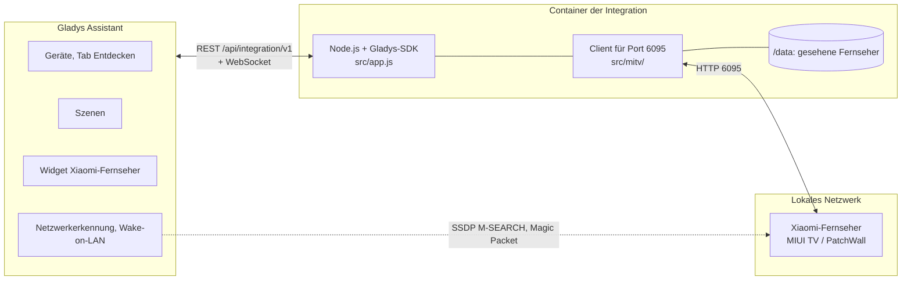
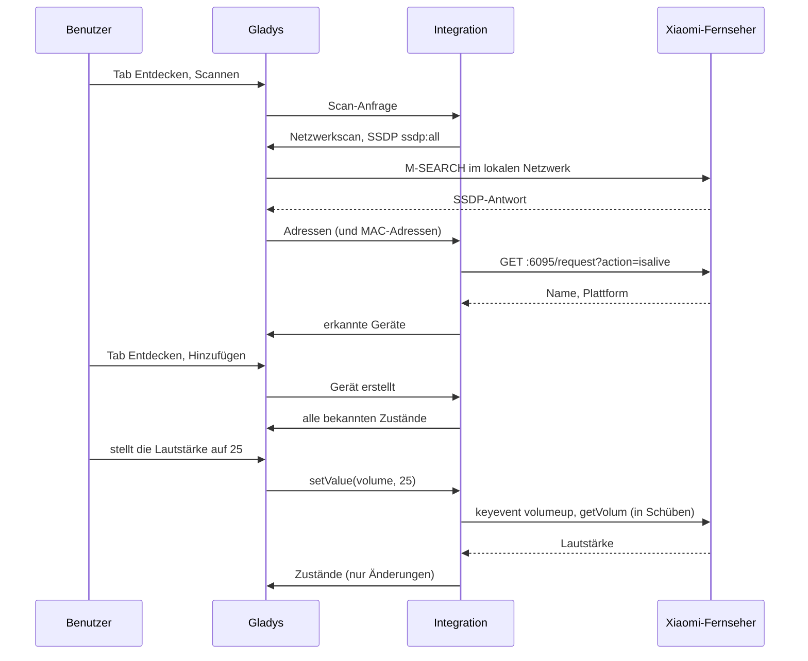
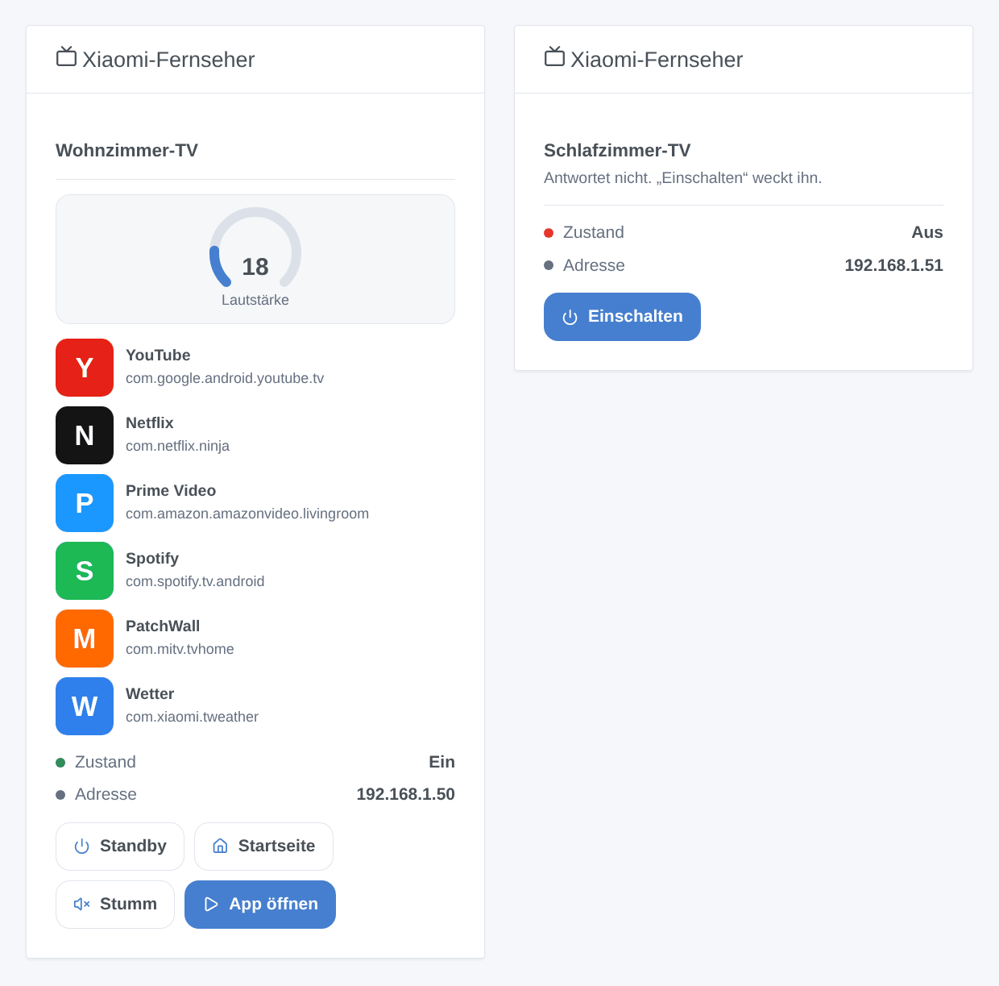

# Xiaomi TV für Gladys Assistant

[English](README.md) | [Français](README.fr.md) | **Deutsch** | [Español](README.es.md)

[](LICENSE)
[](https://github.com/William-De71/gladys-xiaomi-tv/releases)
[](https://github.com/William-De71/gladys-xiaomi-tv/actions/workflows/release.yml)
[](https://gladysassistant.com)


Ihr Xiaomi-Fernseher mit MIUI TV / PatchWall in Gladys Assistant, lokal im Netzwerk gesteuert, ohne Konto und ohne Cloud. Einschalten oder in den Standby schicken, Lautstärke einstellen, die Tasten der Fernbedienung drücken, Apps öffnen und den HDMI-Eingang wechseln – über das Dashboard und in Ihren Szenen.

## Funktionen

- **Erkennung** im lokalen Netzwerk, ohne Konto und ohne Kopplung: Die SSDP-Suche von Gladys findet die Kandidaten, behalten werden nur die Fernseher, die auf Port 6095 antworten; IP-Adressen können für Fernseher eingegeben werden, die sie nicht erreicht. Jeder Fernseher wird über seine MAC-Adresse erkannt und nach einem Adresswechsel wiedergefunden.
- **Ein Gerät pro Fernseher** mit Ein/Standby, Lautstärke (0 bis zum Maximum des Fernsehers) und zehn Fernbedienungstasten als Tasten: lauter, leiser, stumm, hoch, runter, links, rechts, OK, Menü, zurück.
- **Wake-on-LAN** über Gladys, um einen Fernseher einzuschalten, der nicht mehr antwortet, wenn seine MAC-Adresse bekannt ist.
- **Zustände** alle 10 s bis 1 min gelesen (antwortet er, wie laut ist er), mit einem Abzeichen lokal / nicht erreichbar pro Fernseher.
- **Ein Dashboard-Widget**: Zustand, Lautstärke, die ersten sechs Apps mit Symbol und die Tasten Standby / Einschalten, Startseite, Stumm und App öffnen (ein Formular mit allen Apps).
- **Drei Szenenaktionen**: eine App öffnen, eine Tastenfolge drücken, auf einen HDMI-Eingang wechseln.
- Englisch, Französisch, Deutsch und Spanisch.

## Funktionsweise




Der Container der Integration sitzt hinter der Docker-Bridge, von wo ein Multicast das Netzwerk nie erreicht: Gladys im Host-Netzwerk sendet die SSDP-Suche und leitet die Antworten weiter, mit der MAC-Adresse jedes Antwortenden, wenn seine Nachbartabelle sie kennt. Die Integration fragt dann jede Adresse `GET :6095/request?action=isalive`: Nur ein Xiaomi-Fernseher antwortet dort. Befehle sind einfache HTTP-Anfragen an den Fernseher (`keyevent`, `startapp`, `changesource`, `getVolum`, `getinstalledapp`), dieselben wie die der App Mi Remote.




### Geräte und Funktionen

| Funktion                                              | Kategorie / Typ                                          | Werte                            |
| ----------------------------------------------------- | -------------------------------------------------------- | -------------------------------- |
| Ein/Standby                                           | `television` / `binary`                                  | 0 / 1, angenommen (siehe unten)  |
| Lautstärke                                            | `television` / `volume`                                  | 0 bis zum Maximum des Fernsehers |
| Lautstärke höher, Lautstärke niedriger, Stumm         | `television` / `volume-up`, `volume-down`, `volume-mute` | Tasten                           |
| Hoch, Runter, Links, Rechts, Bestätigen, Menü, Zurück | `television` / `up` … `menu`, `return`                   | Tasten                           |

Externe ID des Geräts: `ext:<Selektor>:device:<MAC-Adresse>` (`ip-<Adresse>` für einen in der Konfiguration eingegebenen Fernseher, dessen MAC-Adresse Gladys nicht sieht); Funktionen: `…:power`, `…:volume`, `…:volume_up`, `…:volume_down`, `…:volume_mute`, `…:up`, `…:down`, `…:left`, `…:right`, `…:enter`, `…:menu`, `…:back`.

**Der Ein/Standby-Zustand ist angenommen.** Die Ein-/Aus-Taste schaltet den Fernseher zwischen Betrieb und Standby um, und ein Fernseher im Standby antwortet weiterhin auf Port 6095: Die API kann beides nicht unterscheiden. Der Zustand ist der letzte von Gladys gesendete Befehl, ein, sobald der Fernseher wieder antwortet, aus, wenn er nicht mehr antwortet. **Stumm** senkt die Lautstärke auf 0 und stellt sie wieder her (der Fernseher hat keine Stummtaste), und die Lautstärke wird mit den Lautstärketasten erreicht und nach jedem Schub zurückgelesen (die direkte Anfrage verlangt eine private Signatur).

## Transport

`transports: ["local"]`: Alles bleibt in Ihrem lokalen Netzwerk, nichts verlässt es und kein Konto ist nötig. Jeder Fernseher zeigt ein Abzeichen **lokal** oder **nicht erreichbar**, wenn er nicht antwortet (an der Steckdose aus, tiefer Standby, außerhalb des Netzwerks). Es gibt keinen Cloud-Kanal, also keine Schaltfläche „Lokale Verbindung bevorzugen“.

## Widgets



- **Xiaomi-Fernseher**: ein in den Einstellungen gewählter Fernseher: Zustand, Adresse, eine Lautstärkeanzeige, seine ersten sechs Apps (Symbol, Name, Paketname) und vier Tasten: **Standby** / **Einschalten**, **Startseite**, **Stumm** / **Ton an** und **App öffnen** (ein Formular mit allen Apps des Fernsehers). Ein Fernseher, der nicht antwortet, behält nur **Einschalten** (Wake-on-LAN).

Die Bilder erzeugt `docs/illustrations/render.sh` aus dem echten Code des Widgets: Es sind Illustrationen, keine Screenshots (die App-Symbole sind für die Illustration gezeichnet).

## Szenenauslöser und -aktionen

| Aktion          | Felder                                                                    | Ausgaben              |
| --------------- | ------------------------------------------------------------------------- | --------------------- |
| `launch_app`    | Fernseher, App (Name wie auf dem Fernseher angezeigt oder Paketname)      | `app_name`, `package` |
| `send_keys`     | Fernseher, Tasten (bis zu 30, durch Kommas getrennt), Pause (200-3000 ms) | `keys_sent`           |
| `change_source` | Fernseher, Eingang (HDMI 1, HDMI 2, HDMI 3)                               | keine                 |

Kein Szenenauslöser: Der Fernseher sendet keine Ereignisse, und was die Integration beobachtet (Ein/Standby, Lautstärke), sind Gerätezustände, die der Gladys-Auslöser „Änderung von Gerätestatus“ bereits abdeckt. Beispiele:

- Jeden Abend um 20:30 Uhr, wenn jemand zu Hause ist → **App auf einem Xiaomi-Fernseher öffnen** `Netflix`, dann Wohnzimmerlicht auf 20 %.
- **Der Ein/Standby-Zustand des Fernsehers wird 1** → Wohnzimmerrollläden schließen und das Licht dimmen.
- Wenn die Spielkonsole eingeschaltet wird → **Eingang eines Xiaomi-Fernsehers wechseln** auf HDMI 2, dann Lautstärke auf 30.

## Voraussetzungen

- Gladys Assistant **5.3.0 oder neuer** (Dashboard-Widgets, Szenenaktionen und Tastenformulare von Integrationen, Katalog-Suchbegriffe von Gladys 5.3; ältere Instanzen können die Integration nicht installieren).
- Ein Xiaomi-Fernseher mit **MIUI TV / PatchWall** (vor allem in China und Indien verkauft), der auf `http://<Adresse des Fernsehers>:6095/request?action=isalive` antwortet, im selben Netzwerk wie Gladys. **Modelle mit Android TV und Google TV** (Mi TV P1, Q1, Q2, Xiaomi TV A / A Pro…) haben diese API nicht.
- Eine feste IP-Adresse für den Fernseher im Router wird empfohlen.

## Installation

- **Aus dem Store**: Integrationen → „Xiaomi TV“ suchen → Installieren. Akzeptieren Sie im Installationsbildschirm die Netzwerkerkennung (SSDP) und Wake-on-LAN.
- **Über die Repository-URL**: Integrationen → Integration installieren → `https://github.com/William-De71/gladys-xiaomi-tv` einfügen.
- **Entwicklermodus**: Integrationen → Integration installieren → Entwicklermodus, mit dem Manifest eines Builds (die Zusammenfassung des Workflows „Build and publish image“ zeigt es an).

## Konfiguration

| Feld              | Typ    | Standard | Bedeutung                                                                     |
| ----------------- | ------ | -------- | ----------------------------------------------------------------------------- |
| `hosts`           | string | leer     | IP-Adressen von Fernsehern, die die Suche nicht findet, durch Kommas getrennt |
| `poll_interval`   | select | `10`     | Zustandsaktualisierung in Sekunden: `10`, `30`, `60`                          |
| `rescan_interval` | select | `60`     | automatische Suche in Minuten: `0` (aus), `15`, `60`                          |
| `language`        | select | `en`     | Sprache der Funktionsnamen und der Fehlermeldungen der Szenen                 |

Schaltfläche der Konfigurationsseite: **Fernseher suchen und testen** (durchsucht das Netzwerk und listet jeden Fernseher mit Adresse, MAC-Adresse und Erreichbarkeit auf).

## Verwendung

1. Schalten Sie den Fernseher ein, installieren Sie die Integration und drücken Sie auf ihrer Konfigurationsseite **Fernseher suchen und testen**.
2. Fügen Sie den Fernseher im Tab **Entdecken** hinzu und benennen Sie ihn nach Belieben um.
3. Fügen Sie das Widget einem Dashboard hinzu, erstellen Sie Ihre Szenen.

Die Benutzerdokumentation steht in [docs/de.md](docs/de.md) ([en](docs/en.md), [fr](docs/fr.md), [es](docs/es.md)).

## Grenzen

- Geschrieben nach der Community-Dokumentation der API auf Port 6095 ([pymitv](https://github.com/simse/pymitv), genutzt von der Home-Assistant-Integration „Xiaomi TV“, und [mireco](https://github.com/spocky/mireco)); Xiaomi dokumentiert sie nicht. Gegen simulierte Fernseher getestet, **noch nicht gegen einen echten Fernseher**: Rückmeldungen willkommen.
- Nur Modelle mit MIUI TV / PatchWall; Modelle mit Android TV und Google TV brauchen ein anderes Protokoll (Android TV Remote, Google Cast).
- Der Ein/Standby-Zustand ist angenommen: Ein mit der eigenen Fernbedienung in den Standby geschickter Fernseher bleibt in Gladys bis zum nächsten Befehl eingeschaltet, und ein Fernseher im Standby antwortet weiter.
- Keine aktuelle App, kein Wiedergabezustand, kein Sender, keine direkte Lautstärke: Die API gibt sie ohne die private Signatur nicht preis.
- Eingänge: nur HDMI 1 bis 3 (die anderen Quellen hängen vom Modell ab).
- Wake-on-LAN hängt vom Fernseher ab: Im tiefen Standby ignorieren es manche.

## Lokale Entwicklung

```bash
npm install
GLADYS_HOST_API_URL=http://localhost:1443 \
  GLADYS_INTEGRATION_TOKEN=… GLADYS_INTEGRATION_SELECTOR=… \
  XIAOMI_TV_DATA_DIR=./data DEBUG=gladys-integration-sdk node index.js
```

| Variable                                                                         | Standard           | Verwendung                                |
| -------------------------------------------------------------------------------- | ------------------ | ----------------------------------------- |
| `GLADYS_HOST_API_URL`, `GLADYS_INTEGRATION_TOKEN`, `GLADYS_INTEGRATION_SELECTOR` | von Gladys gesetzt | Verbindung zur Host-API von Gladys        |
| `XIAOMI_TV_DATA_DIR`                                                             | `/data`            | Ordner von `tvs.json`                     |
| `DEBUG`                                                                          | nicht gesetzt      | `gladys-integration-sdk` für die SDK-Logs |

| Skript                            | Was es tut                               |
| --------------------------------- | ---------------------------------------- |
| `npm test`                        | die Tests (`node --test`), ohne Netzwerk |
| `npm run lint`                    | ESLint                                   |
| `npm run format` / `format:check` | Prettier                                 |
| `docs/illustrations/render.sh`    | die Widget-Illustrationen neu erzeugen   |
| `scripts/build-cover.sh`          | `cover.jpg` aus `cover.svg` neu erzeugen |

## Tests

`npm test` lässt die ganze Integration gegen das falsche Gladys des SDK und simulierte Fernseher laufen, die die echten HTTP-Anfragen beantworten (beide Antwortformate der Firmwares): Erkennung per SSDP und per Adresse, bei einer zweiten Suche gelernte MAC-Adresse, angenommener Ein/Standby-Zustand und Wake-on-LAN, Lautstärke im geschlossenen Regelkreis, Stumm, Tasten, Szenenaktionen und ihre Ausgaben, das Widget geprüft mit `validateWidgetContent` und seine Symbole mit `validateWidgetImage`, Adresswechsel und Neustarts. Das Gerät wird gegen die Regeln des Gladys-Kerns und eine Erkennungsreferenz geprüft (externe IDs sind für immer), das Manifest gegen den Code, die Übersetzungen und das Release-Skript. Die CI baut auch das Image und startet es wie Gladys (schreibgeschützt, 256 MB, ohne Netzwerk).

## Release-Prozess

Jeder Merge auf `main` veröffentlicht eine Version, wenn seine Commits es rechtfertigen, ohne manuellen Schritt:


- `feat` → Minor, `fix` / `perf` → Patch, `!` oder `BREAKING CHANGE:` → Major (unter 1.0.0 ein Minor). `docs`, `chore`, `ci`, `test`, `style`, `refactor`, `build` allein veröffentlichen nichts.
- Der Titel des Pull Requests wird zum Squash-Commit und damit zur Changelog-Zeile: Schreiben Sie ihn auf Englisch, für den Benutzer (`feat(widget): …`). `pr-title.yml` prüft ihn. Bearbeiten Sie `CHANGELOG.md` nie von Hand.
- Das Image existiert, bevor `main` seine Version ankündigt (der Store indexiert `main`).
- 1.0.0 ist eine manuelle Entscheidung: Actions → Release → Run workflow, `release-as: 1.0.0`. `dry-run` zeigt Version und Changelog, ohne etwas zu veröffentlichen.
- **Geschütztes `main`**: Das Release pusht einen Commit auf `main`. Mit einem Branch-Schutz oder einem Ruleset erlauben Sie GitHub Actions, ihn zu umgehen (oder nutzen eine GitHub App), sonst stoppt das Release nach dem Image.
- Machen Sie das Paket nach dem ersten Release öffentlich: Package settings → Change visibility → Public.

## Fehlerbehebung

- **Kein Fernseher gefunden**: Prüfen Sie, ob er eingeschaltet und im selben Netzwerk wie Gladys ist und ob `http://<Adresse des Fernsehers>:6095/request?action=isalive` im Browser antwortet. Wenn nicht, hat das Modell diese API nicht. Andernfalls geben Sie seine Adresse in der Konfiguration ein.
- **„Gladys hat die Netzwerksuche abgelehnt“**: Installieren Sie die Integration neu und erlauben Sie im Installationsbildschirm ihren Netzwerkzugriff.
- **Ein/Standby zeigt den falschen Zustand**: Der Zustand ist angenommen; drücken Sie die Taste zweimal.
- **Der Fernseher schaltet sich nicht ein**: Im tiefen Standby ignorieren manche Fernseher Wake-on-LAN, und ein nur über seine eingegebene Adresse gefundener Fernseher hat keine bekannte MAC-Adresse.
- Protokolle: der Tab Protokolle der Integration; `DEBUG=gladys-integration-sdk` für die Details des SDK.

## Mitwirken

Issues und Pull Requests sind willkommen. Führen Sie `npm run format:check`, `npm run lint` und `npm test` aus, schreiben Sie den Titel des Pull Requests als Conventional Commit und starten Sie `docs/illustrations/render.sh` nach jeder Änderung am Inhalt des Widgets neu. Eine neue Funktion darf die vorhandenen nicht ändern (`test/fixtures/discovery.baseline.json`).

## Sicherheit

Siehe [SECURITY.md](SECURITY.md). Kein Konto, kein Passwort und kein Token: Die Integration spricht nur mit den Fernsehern Ihres lokalen Netzwerks. `/data` enthält Adresse, MAC-Adresse, Name und maximale Lautstärke jedes gesehenen Fernsehers.

## Lizenz

[Apache-Lizenz 2.0](LICENSE), siehe auch [NOTICE](NOTICE). Die Anfragen an Port 6095 sind für dieses Projekt nach der Community-Dokumentation (pymitv, mireco) umgesetzt; kein Code wurde kopiert. Xiaomi, Mi und PatchWall sind Marken ihrer Inhaber; dieses Projekt ist weder mit ihnen verbunden noch von ihnen unterstützt oder gebilligt.
