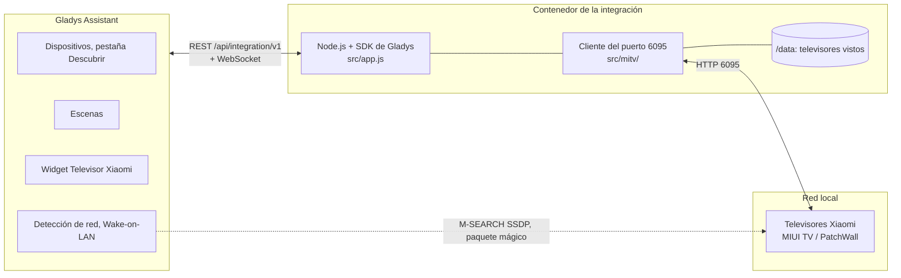
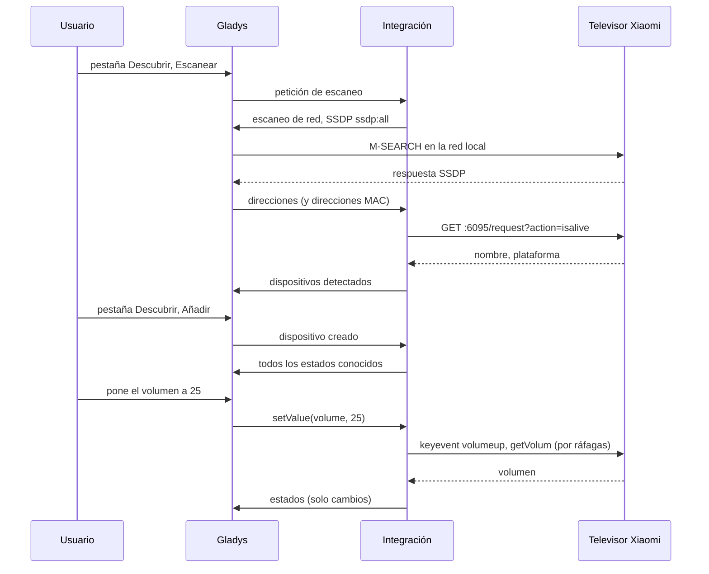
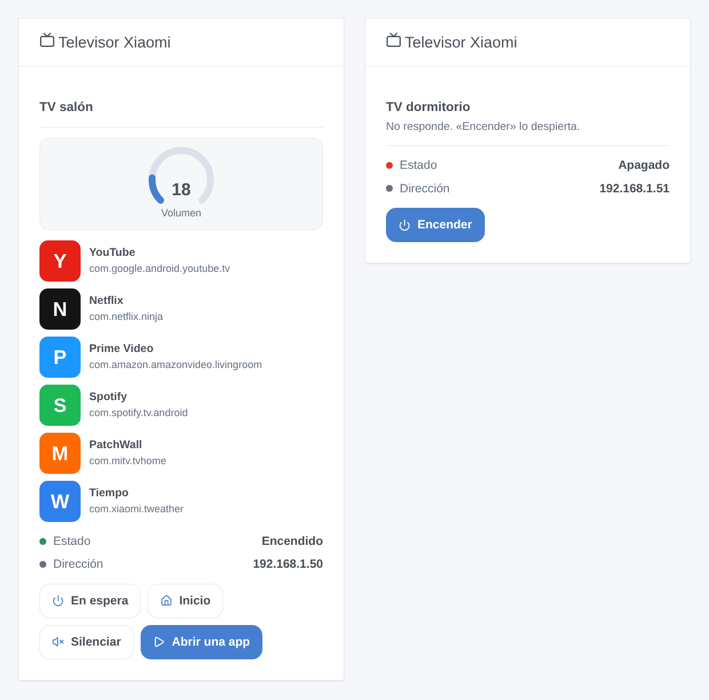

# Xiaomi TV para Gladys Assistant

[English](README.md) | [Français](README.fr.md) | [Deutsch](README.de.md) | **Español**

[](LICENSE)
[](https://github.com/William-De71/gladys-xiaomi-tv/releases)
[](https://github.com/William-De71/gladys-xiaomi-tv/actions/workflows/release.yml)
[](https://gladysassistant.com)


Su televisor Xiaomi con MIUI TV / PatchWall en Gladys Assistant, controlado en su red local, sin cuenta ni nube. Enciéndalo o póngalo en espera, ajuste el volumen, pulse las teclas del mando, abra sus aplicaciones y cambie la entrada HDMI, desde el panel y desde sus escenas.

## Funciones

- **Detección** en la red local, sin cuenta ni emparejamiento: la búsqueda SSDP de Gladys encuentra los candidatos, y solo se conservan los televisores que responden en el puerto 6095; se pueden escribir direcciones IP para los que no alcanza. Cada televisor se identifica por su dirección MAC y se vuelve a encontrar tras un cambio de dirección.
- **Un dispositivo por televisor** con Encendido/espera, Volumen (de 0 al máximo del televisor) y diez teclas del mando mostradas como botones: subir y bajar volumen, silenciar, arriba, abajo, izquierda, derecha, aceptar, menú, volver.
- **Wake-on-LAN** a través de Gladys para encender un televisor que ya no responde, cuando se conoce su dirección MAC.
- **Estados** leídos cada 10 s a 1 min (si responde, cuál es su volumen), con una insignia local / inaccesible por televisor.
- **Un widget de panel**: estado, volumen, las seis primeras aplicaciones con su icono y los botones En espera / Encender, Inicio, Silenciar y Abrir una app (un formulario con todas las aplicaciones).
- **Tres acciones de escena**: abrir una aplicación, pulsar una secuencia de teclas, cambiar a una entrada HDMI.
- Inglés, francés, alemán y español.

## Funcionamiento




El contenedor de la integración está detrás del puente Docker, desde donde un multicast nunca llega a la red: Gladys, en la red del host, envía la búsqueda SSDP y retransmite las respuestas, con la dirección MAC de cada respondedor cuando su tabla de vecinos la conoce. La integración pregunta luego a cada dirección `GET :6095/request?action=isalive`: solo un televisor Xiaomi responde ahí. Las órdenes son simples peticiones HTTP al televisor (`keyevent`, `startapp`, `changesource`, `getVolum`, `getinstalledapp`), las que envía la app Mi Remote.




### Dispositivos y funciones

| Función                                                  | Categoría / tipo                                         | Valores                      |
| -------------------------------------------------------- | -------------------------------------------------------- | ---------------------------- |
| Encendido/espera                                         | `television` / `binary`                                  | 0 / 1, supuesto (ver abajo)  |
| Volumen                                                  | `television` / `volume`                                  | de 0 al máximo del televisor |
| Subir volumen, Bajar volumen, Silenciar                  | `television` / `volume-up`, `volume-down`, `volume-mute` | botones                      |
| Arriba, Abajo, Izquierda, Derecha, Aceptar, Menú, Volver | `television` / `up` … `menu`, `return`                   | botones                      |

Identificador externo del dispositivo: `ext:<selector>:device:<dirección MAC>` (`ip-<dirección>` para un televisor escrito en la configuración cuya dirección MAC Gladys no ve); funciones: `…:power`, `…:volume`, `…:volume_up`, `…:volume_down`, `…:volume_mute`, `…:up`, `…:down`, `…:left`, `…:right`, `…:enter`, `…:menu`, `…:back`.

**El estado de encendido es supuesto.** La tecla de encendido alterna el televisor entre encendido y espera, y un televisor en espera sigue respondiendo en el puerto 6095: la API no permite distinguirlos. El estado es la última orden enviada desde Gladys, encendido cuando el televisor vuelve a responder, apagado cuando deja de responder. **Silenciar** baja el volumen a 0 y lo restablece (el televisor no tiene tecla de silencio), y el volumen se alcanza con las teclas de volumen, releído tras cada ráfaga (la petición directa exige una firma privada).

## Transporte

`transports: ["local"]`: todo se queda en su red local, nada sale de ella y no hace falta cuenta. Cada televisor muestra una insignia **local**, o **inaccesible** cuando no responde (apagado en el enchufe, espera profunda, fuera de la red). No hay canal en la nube, así que no hay botón «Preferir la conexión local».

## Widgets



- **Televisor Xiaomi**: un televisor elegido en los ajustes: estado, dirección, un indicador de volumen, sus seis primeras aplicaciones (icono, nombre, nombre de paquete) y cuatro botones: **En espera** / **Encender**, **Inicio**, **Silenciar** / **Activar sonido** y **Abrir una app** (un formulario con todas las aplicaciones del televisor). Un televisor que no responde solo conserva **Encender** (Wake-on-LAN).

Las imágenes las genera `docs/illustrations/render.sh` a partir del código real del widget: son ilustraciones, no capturas de pantalla (los iconos de las aplicaciones se dibujan para la ilustración).

## Disparadores y acciones de escena

| Acción          | Campos                                                                      | Salidas               |
| --------------- | --------------------------------------------------------------------------- | --------------------- |
| `launch_app`    | televisor, aplicación (nombre que muestra el televisor o nombre de paquete) | `app_name`, `package` |
| `send_keys`     | televisor, teclas (hasta 30, separadas por comas), pausa (200-3000 ms)      | `keys_sent`           |
| `change_source` | televisor, entrada (HDMI 1, HDMI 2, HDMI 3)                                 | ninguna               |

Sin disparador de escena: el televisor no envía ningún evento, y lo que la integración observa (encendido/espera, volumen) son estados de dispositivo, que el disparador de Gladys «Cambio de estado del dispositivo» ya cubre. Ejemplos:

- Cada noche a las 20:30, si hay alguien en casa → **Abrir una app en un televisor Xiaomi** `Netflix`, y luego las luces del salón al 20 %.
- **El estado Encendido/espera del televisor pasa a 1** → cerrar las persianas del salón y atenuar las luces.
- Cuando se enciende la consola → **Cambiar la entrada de un televisor Xiaomi** a HDMI 2, y luego el volumen a 30.

## Requisitos

- Gladys Assistant **5.2.0 o posterior** (widgets de panel, acciones de escena y formularios de botones de las integraciones; las instancias más antiguas no pueden instalar la integración).
- Un televisor Xiaomi con **MIUI TV / PatchWall** (vendido sobre todo en China e India) que responda a `http://<dirección del televisor>:6095/request?action=isalive`, en la misma red que Gladys. **Los modelos Android TV y Google TV** (Mi TV P1, Q1, Q2, Xiaomi TV A / A Pro…) no tienen esta API.
- Se recomienda una dirección IP fija para el televisor en su router.

## Instalación

- **Desde la tienda**: Integraciones → buscar «Xiaomi TV» → Instalar. Acepte la detección de red (SSDP) y el Wake-on-LAN en la pantalla de instalación.
- **Desde la URL del repositorio**: Integraciones → Instalar una integración → pegar `https://github.com/William-De71/gladys-xiaomi-tv`.
- **Modo desarrollador**: Integraciones → Instalar una integración → Modo desarrollador, con el manifiesto de un build (el resumen del workflow «Build and publish image» lo muestra).

## Configuración

| Campo             | Tipo   | Por defecto | Significado                                                                         |
| ----------------- | ------ | ----------- | ----------------------------------------------------------------------------------- |
| `hosts`           | string | vacío       | direcciones IP de los televisores que la búsqueda no encuentra, separadas por comas |
| `poll_interval`   | select | `10`        | actualización del estado en segundos: `10`, `30`, `60`                              |
| `rescan_interval` | select | `60`        | búsqueda automática en minutos: `0` (desactivada), `15`, `60`                       |
| `language`        | select | `en`        | idioma de los nombres de las funciones y de los mensajes de error de escenas        |

Botón de la página de configuración: **Buscar y probar los televisores** (busca en la red y lista cada televisor con su dirección, su dirección MAC y si responde).

## Uso

1. Encienda el televisor, instale la integración y pulse **Buscar y probar los televisores** en su página de configuración.
2. Añada el televisor desde la pestaña **Descubrir** y cámbiele el nombre a su gusto.
3. Añada el widget a un panel, cree sus escenas.

La documentación de usuario está en [docs/es.md](docs/es.md) ([en](docs/en.md), [fr](docs/fr.md), [de](docs/de.md)).

## Límites

- Escrita a partir de la documentación comunitaria de la API del puerto 6095 ([pymitv](https://github.com/simse/pymitv), usada por la integración «Xiaomi TV» de Home Assistant, y [mireco](https://github.com/spocky/mireco)); Xiaomi no la documenta. Probada con televisores simulados, **todavía no con un televisor real**: se agradecen los comentarios.
- Solo modelos MIUI TV / PatchWall; los modelos Android TV y Google TV necesitan otro protocolo (Android TV Remote, Google Cast).
- El estado de encendido es supuesto: un televisor puesto en espera con su propio mando sigue encendido en Gladys hasta la siguiente orden, y un televisor en espera sigue respondiendo.
- Ni aplicación en curso, ni estado de reproducción, ni canal, ni volumen directo: la API no los expone sin la firma privada.
- Entradas: solo HDMI 1 a 3 (las demás fuentes dependen del modelo).
- El Wake-on-LAN depende del televisor: en espera profunda, algunos lo ignoran.

## Desarrollo local

```bash
npm install
GLADYS_HOST_API_URL=http://localhost:1443 \
  GLADYS_INTEGRATION_TOKEN=… GLADYS_INTEGRATION_SELECTOR=… \
  XIAOMI_TV_DATA_DIR=./data DEBUG=gladys-integration-sdk node index.js
```

| Variable                                                                         | Por defecto       | Uso                                            |
| -------------------------------------------------------------------------------- | ----------------- | ---------------------------------------------- |
| `GLADYS_HOST_API_URL`, `GLADYS_INTEGRATION_TOKEN`, `GLADYS_INTEGRATION_SELECTOR` | fijado por Gladys | conexión con la API del host de Gladys         |
| `XIAOMI_TV_DATA_DIR`                                                             | `/data`           | carpeta de `tvs.json`                          |
| `DEBUG`                                                                          | sin definir       | `gladys-integration-sdk` para los logs del SDK |

| Script                            | Qué hace                                   |
| --------------------------------- | ------------------------------------------ |
| `npm test`                        | las pruebas (`node --test`), sin red       |
| `npm run lint`                    | ESLint                                     |
| `npm run format` / `format:check` | Prettier                                   |
| `docs/illustrations/render.sh`    | regenerar las ilustraciones de los widgets |
| `scripts/build-cover.sh`          | regenerar `cover.jpg` desde `cover.svg`    |

## Pruebas

`npm test` ejecuta toda la integración contra el Gladys falso del SDK y televisores simulados que responden a las peticiones HTTP reales (los dos formatos de respuesta de los firmwares): detección por SSDP y por dirección, dirección MAC aprendida en una segunda búsqueda, encendido supuesto y Wake-on-LAN, volumen en lazo cerrado, silencio, teclas, acciones de escena y sus salidas, el widget validado por `validateWidgetContent` y sus iconos por `validateWidgetImage`, cambios de dirección y reinicios. El dispositivo se comprueba contra las reglas del núcleo de Gladys y una referencia de detección (los identificadores externos son para siempre), el manifiesto contra el código, las traducciones y el script de release. La CI también construye la imagen y la arranca como Gladys (solo lectura, 256 MB, sin red).

## Proceso de release

Cada fusión en `main` publica una versión cuando sus commits lo justifican, sin ningún paso manual:


- `feat` → minor, `fix` / `perf` → patch, `!` o `BREAKING CHANGE:` → major (un minor por debajo de 1.0.0). `docs`, `chore`, `ci`, `test`, `style`, `refactor`, `build` solos no publican nada.
- El título de la pull request se convierte en el commit de squash, y por tanto en la línea del changelog: escríbalo en inglés, para el usuario (`feat(widget): …`). `pr-title.yml` lo comprueba. No edite nunca `CHANGELOG.md` a mano.
- La imagen existe antes de que `main` anuncie su versión (la tienda indexa `main`).
- La 1.0.0 es una decisión manual: Actions → Release → Run workflow, `release-as: 1.0.0`. `dry-run` muestra la versión y el changelog sin publicar nada.
- **`main` protegida**: la release empuja un commit a `main`. Con una protección de rama o un ruleset, permita que GitHub Actions la omita (o use una GitHub App); si no, la release se detiene tras la imagen.
- Tras la primera release, haga público el paquete: Package settings → Change visibility → Public.

## Solución de problemas

- **No se encuentra ningún televisor**: compruebe que está encendido, en la misma red que Gladys, y que `http://<dirección del televisor>:6095/request?action=isalive` responde en un navegador. Si no, el modelo no tiene esta API. Si responde, escriba su dirección en la configuración.
- **«Gladys rechazó la búsqueda en la red»**: reinstale la integración y acepte su acceso a la red en la pantalla de instalación.
- **Encendido/espera muestra un estado erróneo**: el estado es supuesto; pulse el botón dos veces.
- **El televisor no se enciende**: en espera profunda, algunos televisores ignoran el Wake-on-LAN, y un televisor encontrado solo por su dirección escrita no tiene dirección MAC conocida.
- Registros: la pestaña Registros de la integración; `DEBUG=gladys-integration-sdk` para el detalle del SDK.

## Contribuir

Las issues y pull requests son bienvenidas. Ejecute `npm run format:check`, `npm run lint` y `npm test`, escriba el título de la pull request como Conventional Commit y vuelva a lanzar `docs/illustrations/render.sh` tras cualquier cambio en el contenido del widget. Una función nueva no debe modificar las existentes (`test/fixtures/discovery.baseline.json`).

## Seguridad

Consulte [SECURITY.md](SECURITY.md). Sin cuenta, sin contraseña y sin token: la integración solo habla con los televisores de su red local. `/data` contiene la dirección, la dirección MAC, el nombre y el volumen máximo de cada televisor visto.

## Licencia

[Licencia Apache 2.0](LICENSE), ver también [NOTICE](NOTICE). Las peticiones del puerto 6095 están implementadas para este proyecto a partir de la documentación comunitaria (pymitv, mireco); no se ha copiado código. Xiaomi, Mi y PatchWall son marcas de sus propietarios; este proyecto no está afiliado a ellos ni cuenta con su respaldo o apoyo.
