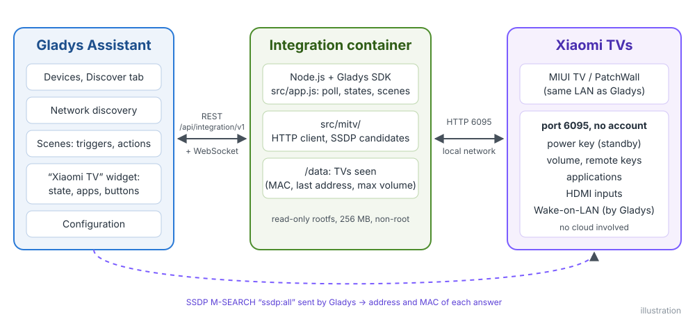
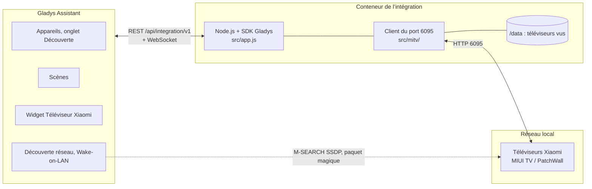
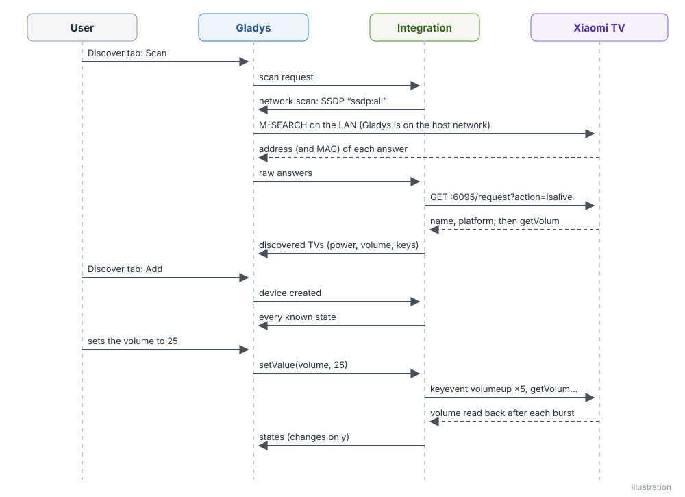
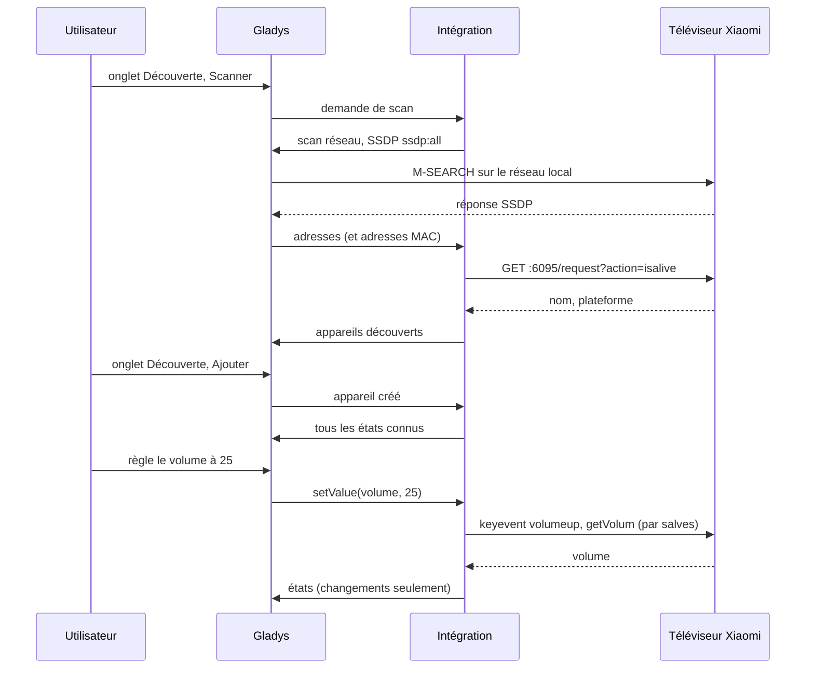
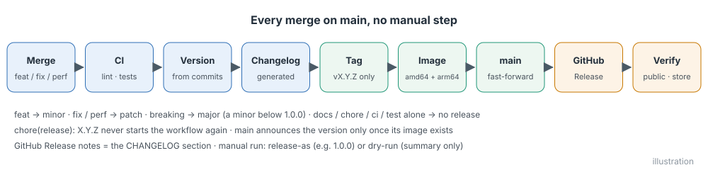

# Xiaomi TV pour Gladys Assistant

[English](README.md) | **Français** | [Deutsch](README.de.md) | [Español](README.es.md)

[](LICENSE)
[](https://github.com/William-De71/gladys-xiaomi-tv/releases)
[](https://github.com/William-De71/gladys-xiaomi-tv/actions/workflows/release.yml)
[](https://gladysassistant.com)


Votre téléviseur Xiaomi sous MIUI TV / PatchWall dans Gladys Assistant, piloté sur votre réseau local, sans compte ni cloud. Allumez-le ou mettez-le en veille, réglez son volume, appuyez sur les touches de sa télécommande, ouvrez ses applications et changez d’entrée HDMI, depuis le tableau de bord et vos scènes.

## Fonctionnalités

- **Découverte** sur le réseau local, sans compte ni appairage : la recherche SSDP de Gladys trouve les candidats, et seuls les téléviseurs qui répondent sur le port 6095 sont gardés ; des adresses IP peuvent être saisies pour ceux qu’elle n’atteint pas. Chaque téléviseur est identifié par son adresse MAC et retrouvé après un changement d’adresse.
- **Un appareil par téléviseur** avec Marche/veille, Volume (de 0 au maximum du téléviseur) et dix touches de télécommande affichées en boutons : augmenter et diminuer le volume, muet, haut, bas, gauche, droite, OK, menu, retour.
- **Wake-on-LAN** via Gladys pour allumer un téléviseur qui ne répond plus, quand son adresse MAC est connue.
- **États** lus toutes les 10 s à 1 min (répond-il, quel est son volume), avec un badge local / injoignable par téléviseur.
- **Un widget de tableau de bord** : état, volume, les six premières applications avec leur icône, et les boutons Mettre en veille / Allumer, Accueil, Sourdine et Ouvrir une appli (un formulaire qui liste toutes les applications).
- **Trois actions de scène** : ouvrir une application, appuyer sur une séquence de touches, passer sur une entrée HDMI.
- Anglais, français, allemand et espagnol.

## Fonctionnement





Le conteneur de l’intégration est derrière le pont Docker, d’où un multicast n’atteint jamais le réseau : Gladys, sur le réseau de l’hôte, envoie la recherche SSDP et relaie les réponses, avec l’adresse MAC de chaque répondant quand sa table de voisinage la connaît. L’intégration demande ensuite à chaque adresse `GET :6095/request?action=isalive` : seul un téléviseur Xiaomi y répond. Les commandes sont de simples requêtes HTTP au téléviseur (`keyevent`, `startapp`, `changesource`, `getVolum`, `getinstalledapp`), celles qu’envoie l’application Mi Remote.





### Appareils et fonctionnalités

| Fonctionnalité                              | Catégorie / type                                         | Valeurs                        |
| ------------------------------------------- | -------------------------------------------------------- | ------------------------------ |
| Marche/veille                               | `television` / `binary`                                  | 0 / 1, supposé (voir plus bas) |
| Volume                                      | `television` / `volume`                                  | de 0 au maximum du téléviseur  |
| Augmenter volume, Diminuer volume, Muet     | `television` / `volume-up`, `volume-down`, `volume-mute` | boutons                        |
| Haut, Bas, Gauche, Droite, OK, Menu, Retour | `television` / `up` … `menu`, `return`                   | boutons                        |

Identifiant externe de l’appareil : `ext:<sélecteur>:device:<adresse MAC>` (`ip-<adresse>` pour un téléviseur saisi dans la configuration dont Gladys ne voit pas l’adresse MAC) ; fonctionnalités : `…:power`, `…:volume`, `…:volume_up`, `…:volume_down`, `…:volume_mute`, `…:up`, `…:down`, `…:left`, `…:right`, `…:enter`, `…:menu`, `…:back`.

**L’état marche/veille est supposé.** La touche marche fait passer le téléviseur de la marche à la veille et inversement, et un téléviseur en veille répond toujours sur le port 6095 : l’API ne permet pas de les distinguer. L’état est la dernière commande envoyée depuis Gladys, allumé quand le téléviseur se remet à répondre, éteint quand il ne répond plus. **Muet** baisse le volume à 0 puis le rétablit (le téléviseur n’a pas de touche sourdine), et le volume est atteint avec les touches de volume, relu après chaque salve (la requête directe exige une signature privée).

## Transport

`transports: ["local"]` : tout reste sur votre réseau local, rien n’en sort et aucun compte n’est nécessaire. Chaque téléviseur affiche un badge **local**, ou **injoignable** quand il ne répond pas (coupé au mur, veille profonde, hors du réseau). Il n’y a pas de canal cloud, donc pas de bouton « Préférer la connexion locale ».

## Widgets


- **Téléviseur Xiaomi** : un téléviseur choisi dans les réglages : état, adresse, une jauge de volume, ses six premières applications (icône, nom, nom de paquet) et quatre boutons : **Mettre en veille** / **Allumer**, **Accueil**, **Sourdine** / **Rétablir le son** et **Ouvrir une appli** (un formulaire qui liste toutes les applications du téléviseur). Un téléviseur qui ne répond pas ne garde que **Allumer** (Wake-on-LAN).

Les images sont générées par `docs/illustrations/render.sh` à partir du vrai code du widget : ce sont des illustrations, pas des captures d’écran (les icônes d’applications sont dessinées pour l’illustration).

## Déclencheurs et actions de scène

| Action          | Champs                                                                           | Sorties               |
| --------------- | -------------------------------------------------------------------------------- | --------------------- |
| `launch_app`    | téléviseur, application (nom affiché sur le téléviseur ou nom de paquet)         | `app_name`, `package` |
| `send_keys`     | téléviseur, touches (jusqu’à 30, séparées par des virgules), pause (200-3000 ms) | `keys_sent`           |
| `change_source` | téléviseur, entrée (HDMI 1, HDMI 2, HDMI 3)                                      | aucune                |

Pas de déclencheur de scène : le téléviseur n’envoie aucun événement, et ce que l’intégration observe (marche/veille, volume) sont des états d’appareil, que le déclencheur de Gladys « Changement d’état de l’appareil » couvre déjà. Exemples :

- Tous les soirs à 20 h 30, si quelqu’un est à la maison → **Ouvrir une appli sur un téléviseur Xiaomi** `Netflix`, puis lumières du salon à 20 %.
- **L’état Marche/veille du téléviseur passe à 1** → fermer les volets du salon et tamiser les lumières.
- Quand la console de jeux s’allume → **Changer l’entrée d’un téléviseur Xiaomi** sur HDMI 2, puis volume à 30.

## Prérequis

- Gladys Assistant **5.3.0 ou plus récent** (widgets de tableau de bord, actions de scène et formulaires de boutons des intégrations, mots-clés du catalogue de Gladys 5.3 ; les instances plus anciennes ne peuvent pas installer l’intégration).
- Un téléviseur Xiaomi sous **MIUI TV / PatchWall** (surtout vendu en Chine et en Inde) qui répond à `http://<adresse du téléviseur>:6095/request?action=isalive`, sur le même réseau que Gladys. **Les modèles Android TV et Google TV** (Mi TV P1, Q1, Q2, Xiaomi TV A / A Pro…) n’ont pas cette API.
- Une adresse IP fixe pour le téléviseur dans votre box est recommandée.

## Installation

- **Depuis le store** : Intégrations → chercher « Xiaomi TV » → Installer. Acceptez la découverte réseau (SSDP) et le Wake-on-LAN sur l’écran d’installation.
- **Depuis l’URL du dépôt** : Intégrations → Installer une intégration → coller `https://github.com/William-De71/gladys-xiaomi-tv`.
- **Mode développeur** : Intégrations → Installer une intégration → Mode développeur, avec le manifeste d’un build (le résumé du workflow « Build and publish image » l’affiche).

## Configuration

| Champ             | Type   | Défaut | Signification                                                                         |
| ----------------- | ------ | ------ | ------------------------------------------------------------------------------------- |
| `hosts`           | string | vide   | adresses IP des téléviseurs que la recherche ne trouve pas, séparées par des virgules |
| `poll_interval`   | select | `10`   | actualisation de l’état en secondes : `10`, `30`, `60`                                |
| `rescan_interval` | select | `60`   | recherche automatique en minutes : `0` (désactivée), `15`, `60`                       |
| `language`        | select | `en`   | langue des noms de fonctionnalités et des messages d’erreur des scènes                |

Bouton de la page de configuration : **Rechercher et tester les téléviseurs** (cherche sur le réseau et liste chaque téléviseur avec son adresse, son adresse MAC et s’il répond).

## Utilisation

1. Allumez le téléviseur, installez l’intégration, puis appuyez sur **Rechercher et tester les téléviseurs** dans sa page de configuration.
2. Ajoutez le téléviseur depuis l’onglet **Découverte**, et renommez-le à votre guise.
3. Ajoutez le widget à un tableau de bord, créez vos scènes.

La documentation utilisateur est dans [docs/fr.md](docs/fr.md) ([en](docs/en.md), [de](docs/de.md), [es](docs/es.md)).

## Limites

- Écrite d’après la documentation communautaire de l’API du port 6095 ([pymitv](https://github.com/simse/pymitv), utilisée par l’intégration « Xiaomi TV » de Home Assistant, et [mireco](https://github.com/spocky/mireco)) ; Xiaomi ne la documente pas. Testée contre des téléviseurs simulés, **pas encore contre un vrai téléviseur** : les retours sont bienvenus.
- Seulement les modèles MIUI TV / PatchWall ; les modèles Android TV et Google TV demandent un autre protocole (Android TV Remote, Google Cast).
- L’état marche/veille est supposé : un téléviseur mis en veille avec sa propre télécommande reste allumé dans Gladys jusqu’à la commande suivante, et un téléviseur en veille continue de répondre.
- Ni application en cours, ni état de lecture, ni chaîne, ni volume direct : l’API ne les expose pas sans la signature privée.
- Entrées : HDMI 1 à 3 seulement (les autres sources dépendent du modèle).
- Le Wake-on-LAN dépend du téléviseur : en veille profonde, certains l’ignorent.

## Développement local

```bash
npm install
GLADYS_HOST_API_URL=http://localhost:1443 \
  GLADYS_INTEGRATION_TOKEN=… GLADYS_INTEGRATION_SELECTOR=… \
  XIAOMI_TV_DATA_DIR=./data DEBUG=gladys-integration-sdk node index.js
```

| Variable                                                                         | Défaut          | Usage                                         |
| -------------------------------------------------------------------------------- | --------------- | --------------------------------------------- |
| `GLADYS_HOST_API_URL`, `GLADYS_INTEGRATION_TOKEN`, `GLADYS_INTEGRATION_SELECTOR` | fixé par Gladys | connexion à l’API hôte de Gladys              |
| `XIAOMI_TV_DATA_DIR`                                                             | `/data`         | dossier de `tvs.json`                         |
| `DEBUG`                                                                          | non défini      | `gladys-integration-sdk` pour les logs du SDK |

| Script                            | Rôle                                     |
| --------------------------------- | ---------------------------------------- |
| `npm test`                        | les tests (`node --test`), sans réseau   |
| `npm run lint`                    | ESLint                                   |
| `npm run format` / `format:check` | Prettier                                 |
| `docs/illustrations/render.sh`    | régénérer les illustrations des widgets  |
| `scripts/build-cover.sh`          | régénérer `cover.jpg` depuis `cover.svg` |

## Tests

`npm test` fait tourner toute l’intégration contre le faux Gladys du SDK et des téléviseurs simulés qui répondent aux vraies requêtes HTTP (les deux formats de réponse des firmwares) : découverte par SSDP et par adresse, adresse MAC apprise à une seconde recherche, marche/veille supposée et Wake-on-LAN, volume en boucle fermée, sourdine, touches, actions de scène et leurs sorties, widget validé par `validateWidgetContent` et ses icônes par `validateWidgetImage`, changements d’adresse et redémarrages. L’appareil est vérifié contre les règles du cœur de Gladys et une référence de découverte (les identifiants externes sont éternels), le manifeste contre le code, les traductions et le script de release. La CI construit aussi l’image et la démarre comme Gladys (lecture seule, 256 Mo, sans réseau).

## Processus de release

Chaque fusion sur `main` publie une version quand ses commits le justifient, sans aucune étape manuelle :




- `feat` → mineure, `fix` / `perf` → correctif, `!` ou `BREAKING CHANGE:` → majeure (une mineure tant qu’on est sous 1.0.0). `docs`, `chore`, `ci`, `test`, `style`, `refactor`, `build` seuls ne publient rien.
- Le titre de la pull request devient le commit de squash, donc la ligne du changelog : écrivez-le en anglais, pour l’utilisateur (`feat(widget): …`). `pr-title.yml` le vérifie. Ne modifiez jamais `CHANGELOG.md` à la main.
- L’image existe avant que `main` annonce sa version (le store indexe `main`).
- La 1.0.0 est une décision manuelle : Actions → Release → Run workflow, `release-as: 1.0.0`. `dry-run` montre la version et le changelog sans rien publier.
- **`main` protégée** : la release pousse un commit sur `main`. Avec une protection de branche ou un ruleset, autorisez GitHub Actions à la contourner (ou utilisez une GitHub App), sinon la release s’arrête après l’image.
- Après la première release, rendez le package public : Package settings → Change visibility → Public.

## Dépannage

- **Aucun téléviseur trouvé** : vérifiez qu’il est allumé, sur le même réseau que Gladys, et que `http://<adresse du téléviseur>:6095/request?action=isalive` répond dans un navigateur. Sinon, le modèle n’a pas cette API. Sinon encore, saisissez son adresse dans la configuration.
- **« Gladys a refusé la recherche réseau »** : réinstallez l’intégration et acceptez son accès réseau sur l’écran d’installation.
- **Marche/veille affiche le mauvais état** : l’état est supposé ; appuyez deux fois sur le bouton.
- **Le téléviseur ne s’allume pas** : en veille profonde, certains téléviseurs ignorent le Wake-on-LAN, et un téléviseur trouvé seulement par son adresse saisie n’a pas d’adresse MAC connue.
- Journaux : l’onglet Journaux de l’intégration ; `DEBUG=gladys-integration-sdk` pour le détail du SDK.

## Contribuer

Les issues et pull requests sont bienvenues. Lancez `npm run format:check`, `npm run lint` et `npm test`, écrivez le titre de la pull request en Conventional Commit, et relancez `docs/illustrations/render.sh` après tout changement du contenu du widget. Une nouvelle fonctionnalité ne doit pas modifier les existantes (`test/fixtures/discovery.baseline.json`).

## Sécurité

Voir [SECURITY.md](SECURITY.md). Ni compte, ni mot de passe, ni jeton : l’intégration ne parle qu’aux téléviseurs de votre réseau local. `/data` contient l’adresse, l’adresse MAC, le nom et le volume maximum de chaque téléviseur vu.

## Licence

[Licence Apache 2.0](LICENSE), voir aussi [NOTICE](NOTICE). Les requêtes du port 6095 sont implémentées pour ce projet d’après la documentation communautaire (pymitv, mireco) ; aucun code n’est copié. Xiaomi, Mi et PatchWall sont des marques de leurs propriétaires ; ce projet n’est ni affilié à eux, ni approuvé, ni soutenu par eux.
