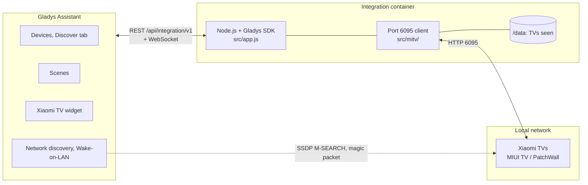
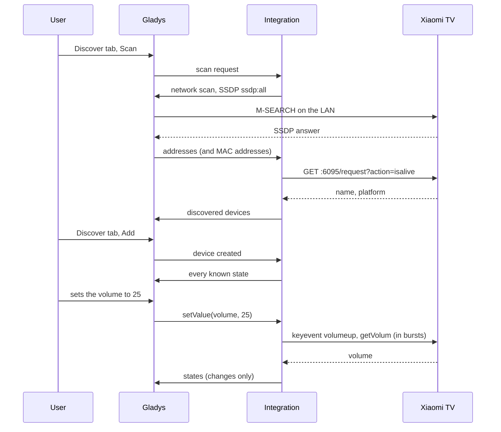
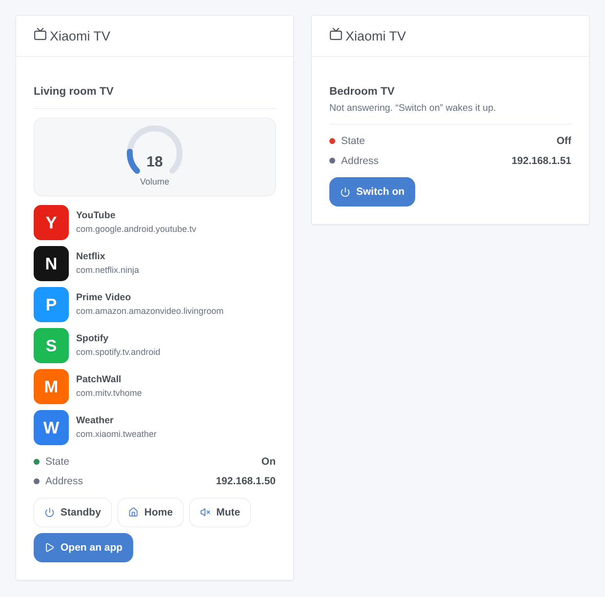

# Xiaomi TV for Gladys Assistant

**English** | [Français](README.fr.md) | [Deutsch](README.de.md) | [Español](README.es.md)

[](LICENSE)
[](https://github.com/William-De71/gladys-xiaomi-tv/releases)
[](https://github.com/William-De71/gladys-xiaomi-tv/actions/workflows/release.yml)
[](https://gladysassistant.com)


Your Xiaomi TV running MIUI TV / PatchWall in Gladys Assistant, controlled on your local network with no account and no cloud. Switch it on or to standby, set its volume, press its remote keys, open its applications and switch its HDMI input, from the dashboard and from your scenes.

## Features

- **Discovery** on the local network, without any account or pairing: the SSDP search of Gladys finds the candidates, and only the TVs answering on port 6095 are kept; IP addresses can be typed for the TVs it cannot reach. Each TV is identified by its MAC address and found again after an address change.
- **One device per TV** with On/Standby, Volume (0 to the maximum of the TV) and ten remote keys shown as push buttons: volume up, volume down, mute, up, down, left, right, OK, menu, back.
- **Wake-on-LAN** through Gladys to switch on a TV that no longer answers, when its MAC address is known.
- **States** read every 10 s to 1 min (does it answer, what is its volume), with a local / unreachable badge per TV.
- **A dashboard widget**: state, volume, the first six applications with their icons, and the buttons Standby / Switch on, Home, Mute and Open an app (a form listing every application).
- **Three scene actions**: open an application, press a sequence of keys, switch to an HDMI input.
- English, French, German and Spanish.

## How it works




The integration container sits behind the Docker bridge, where a multicast never reaches the network: Gladys, on the host network, sends the SSDP search and relays the answers, with the MAC address of each responder when its neighbour table knows it. The integration then asks every address `GET :6095/request?action=isalive`: only a Xiaomi TV answers there. Commands are plain HTTP requests to the TV (`keyevent`, `startapp`, `changesource`, `getVolum`, `getinstalledapp`), the ones the Mi Remote app sends.




### Devices and features

| Feature                               | Category / type                                          | Values                     |
| ------------------------------------- | -------------------------------------------------------- | -------------------------- |
| On/Standby                            | `television` / `binary`                                  | 0 / 1, assumed (see below) |
| Volume                                | `television` / `volume`                                  | 0 to the maximum of the TV |
| Volume up, Volume down, Mute          | `television` / `volume-up`, `volume-down`, `volume-mute` | push buttons               |
| Up, Down, Left, Right, OK, Menu, Back | `television` / `up` … `menu`, `return`                   | push buttons               |

Device external id: `ext:<selector>:device:<MAC address>` (`ip-<address>` for a TV typed in the configuration whose MAC address Gladys cannot see); features: `…:power`, `…:volume`, `…:volume_up`, `…:volume_down`, `…:volume_mute`, `…:up`, `…:down`, `…:left`, `…:right`, `…:enter`, `…:menu`, `…:back`.

**The power state is assumed.** The power key toggles the TV between on and standby, and a TV in standby still answers on port 6095: the API cannot tell them apart. The state is the last command sent from Gladys, on when the TV starts answering again, off when it stops answering. **Mute** lowers the volume to 0 and restores it (the TV has no mute key), and the volume is reached with the volume keys, read back after each burst (the direct volume request needs a private signature).

## Transport

`transports: ["local"]`: everything stays on your local network, nothing leaves it and no account is needed. Each TV shows a **local** badge, or **unreachable** when it does not answer (switched off at the wall, deep standby, out of the network). There is no cloud channel, so no "Prefer the local connection" button.

## Widgets



- **Xiaomi TV**: one TV chosen in the settings: state, address, a volume gauge, its first six applications (icon, name, package name), and four buttons: **Standby** / **Switch on**, **Home**, **Mute** / **Sound on** and **Open an app** (a form listing every application of the TV). A TV that does not answer only keeps **Switch on** (Wake-on-LAN).

The images are generated by `docs/illustrations/render.sh` from the real widget code: they are illustrations, not screenshots (the application icons are drawn for the illustration).

## Scene triggers and actions

| Action          | Fields                                                    | Outputs               |
| --------------- | --------------------------------------------------------- | --------------------- |
| `launch_app`    | TV, application (name as shown on the TV or package name) | `app_name`, `package` |
| `send_keys`     | TV, keys (up to 30, comma-separated), pause (200-3000 ms) | `keys_sent`           |
| `change_source` | TV, input (HDMI 1, HDMI 2, HDMI 3)                        | none                  |

No scene trigger: the TV pushes no event, and what the integration observes (on/standby, volume) are device states, which the Gladys trigger "Device state change" already covers. Examples:

- Every evening at 8:30 pm, if someone is at home → **Open an app on a Xiaomi TV** `Netflix`, then set the living room lights to 20 %.
- **The On/Standby state of the TV becomes 1** → close the living room shutters and dim the lights.
- When the game console is switched on → **Switch a Xiaomi TV input** to HDMI 2, then set the volume to 30.

## Requirements

- Gladys Assistant **5.2.0 or later** (dashboard widgets, scene actions and widget button forms of integrations; older instances cannot install the integration).
- A Xiaomi TV running **MIUI TV / PatchWall** (mostly sold in China and India) that answers `http://<TV address>:6095/request?action=isalive`, on the same network as Gladys. **Android TV and Google TV models** (Mi TV P1, Q1, Q2, Xiaomi TV A / A Pro…) do not have this API.
- A fixed IP address for the TV in your router is recommended.

## Installation

- **From the store**: Integrations → search "Xiaomi TV" → Install. Accept the network discovery (SSDP) and Wake-on-LAN on the install screen.
- **From the repository URL**: Integrations → Install an integration → paste `https://github.com/William-De71/gladys-xiaomi-tv`.
- **Developer mode**: Integrations → Install an integration → Developer mode, with the manifest of a build (the summary of the "Build and publish image" workflow prints it).

## Configuration

| Field             | Type   | Default | Meaning                                                           |
| ----------------- | ------ | ------- | ----------------------------------------------------------------- |
| `hosts`           | string | empty   | IP addresses of TVs the search does not find, separated by commas |
| `poll_interval`   | select | `10`    | state refresh in seconds: `10`, `30`, `60`                        |
| `rescan_interval` | select | `60`    | automatic search in minutes: `0` (off), `15`, `60`                |
| `language`        | select | `en`    | language of the feature names and of the scene error messages     |

Button of the configuration page: **Search and test the TVs** (searches the network and lists every TV with its address, its MAC address and whether it answers).

## Usage

1. Switch the TV on, install the integration, then press **Search and test the TVs** on its configuration page.
2. Add the TV from the **Discover** tab, and rename it as you like.
3. Add the widget to a dashboard, create your scenes.

The user documentation is in [docs/en.md](docs/en.md) ([fr](docs/fr.md), [de](docs/de.md), [es](docs/es.md)).

## Limits

- Written from the community documentation of the port 6095 API ([pymitv](https://github.com/simse/pymitv), used by the Home Assistant "Xiaomi TV" integration, and [mireco](https://github.com/spocky/mireco)); Xiaomi does not document it. Tested against simulated TVs, **not yet against a real TV**: feedback welcome.
- Only MIUI TV / PatchWall models; Android TV and Google TV models need another protocol (Android TV Remote, Google Cast).
- The power state is assumed: a TV put in standby with its own remote still shows on in Gladys until the next command, and a TV in standby keeps answering.
- No current application, no playback state, no channel, no direct volume: the API does not expose them without the private signature.
- Inputs: HDMI 1 to 3 only (the other sources depend on the model).
- Wake-on-LAN depends on the TV: in deep standby, some ignore it.

## Local development

```bash
npm install
GLADYS_HOST_API_URL=http://localhost:1443 \
  GLADYS_INTEGRATION_TOKEN=… GLADYS_INTEGRATION_SELECTOR=… \
  XIAOMI_TV_DATA_DIR=./data DEBUG=gladys-integration-sdk node index.js
```

| Variable                                                                         | Default       | Use                                       |
| -------------------------------------------------------------------------------- | ------------- | ----------------------------------------- |
| `GLADYS_HOST_API_URL`, `GLADYS_INTEGRATION_TOKEN`, `GLADYS_INTEGRATION_SELECTOR` | set by Gladys | connection to the Gladys host API         |
| `XIAOMI_TV_DATA_DIR`                                                             | `/data`       | folder of `tvs.json`                      |
| `DEBUG`                                                                          | unset         | `gladys-integration-sdk` for the SDK logs |

| Script                            | What it does                            |
| --------------------------------- | --------------------------------------- |
| `npm test`                        | the tests (`node --test`), no network   |
| `npm run lint`                    | ESLint                                  |
| `npm run format` / `format:check` | Prettier                                |
| `docs/illustrations/render.sh`    | regenerate the widget illustrations     |
| `scripts/build-cover.sh`          | regenerate `cover.jpg` from `cover.svg` |

## Tests

`npm test` runs the whole integration against the fake Gladys of the SDK and simulated TVs answering the real HTTP requests (both firmware answer formats): discovery by SSDP and by address, the MAC address learnt on a second search, assumed power and Wake-on-LAN, the closed-loop volume, mute, keys, scene actions and their outputs, the widget validated by `validateWidgetContent` and its icons by `validateWidgetImage`, address changes and restarts. The device is checked against the rules of the Gladys core and a discovery baseline (external ids are forever), the manifest against the code, the translations and the release script. The CI also builds the image and starts it like Gladys does (read-only, 256 MB, no network).

## Release process

Every merge on `main` publishes a release when its commits deserve one, with no manual step:


- `feat` → minor, `fix` / `perf` → patch, `!` or `BREAKING CHANGE:` → major (a minor below 1.0.0). `docs`, `chore`, `ci`, `test`, `style`, `refactor`, `build` alone publish nothing.
- The pull request title becomes the squash commit, hence the changelog line: write it in English, for the user (`feat(widget): …`). `pr-title.yml` checks it. Never edit `CHANGELOG.md` by hand.
- The image exists before `main` announces its version (the store indexes `main`).
- 1.0.0 is a manual decision: Actions → Release → Run workflow, `release-as: 1.0.0`. `dry-run` shows the version and the changelog without publishing.
- **Protected `main`**: the release pushes a commit to `main`. With a branch protection or a ruleset, allow GitHub Actions to bypass it (or use a GitHub App), otherwise the release stops after the image.
- After the first release, make the package public: Package settings → Change visibility → Public.

## Troubleshooting

- **No TV found**: check that the TV is on, on the same network as Gladys, and that `http://<TV address>:6095/request?action=isalive` answers in a browser. If it does not, the model does not have this API. Otherwise type its address in the configuration.
- **"Gladys refused the network search"**: reinstall the integration and accept its network access on the install screen.
- **On/Standby shows the wrong state**: the state is assumed; press the button twice.
- **The TV does not switch on**: in deep standby some TVs ignore Wake-on-LAN, and a TV found only by its typed address has no known MAC address.
- Logs: the Logs tab of the integration; `DEBUG=gladys-integration-sdk` for the SDK details.

## Contributing

Issues and pull requests are welcome. Run `npm run format:check`, `npm run lint` and `npm test`, write the pull request title as a Conventional Commit, and run `docs/illustrations/render.sh` after any change to the widget content. A new feature must not change the existing ones (`test/fixtures/discovery.baseline.json`).

## Security

See [SECURITY.md](SECURITY.md). No account, no password and no token: the integration only talks to the TVs of your local network. `/data` holds the address, the MAC address, the name and the maximum volume of each TV seen.

## License

[Apache License 2.0](LICENSE), see also [NOTICE](NOTICE). The port 6095 requests are implemented for this project from the community documentation (pymitv, mireco); no code is copied. Xiaomi, Mi and PatchWall are trademarks of their owners; this project is not affiliated with, endorsed or supported by them.
